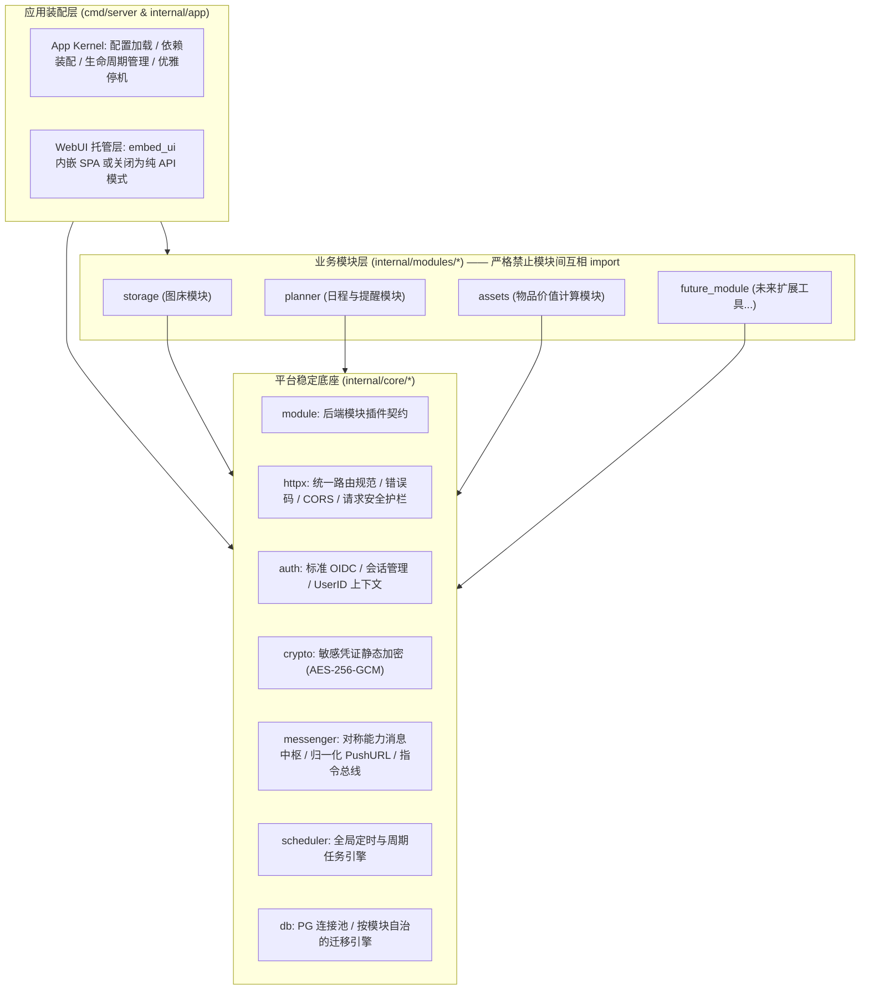
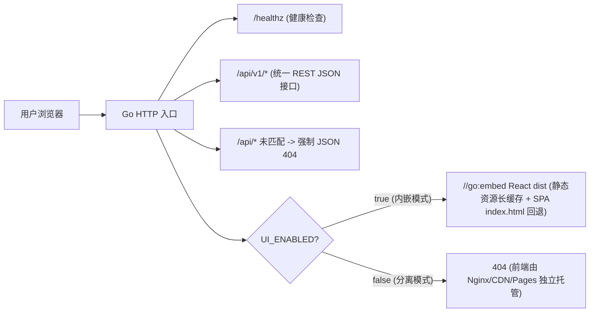
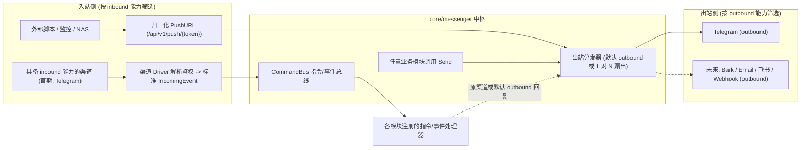

# YukiDeck：总体架构与可扩展框架设计

## 概述

本方案是 YukiDeck 的**顶层架构与平台框架设计稿**，核心聚焦在：**系统宏观定位、可扩展/可维护的模块化骨架、内嵌与分离双模式部署机制、以及平台公共底座的能力边界**。

各具体业务模块（图床、日程与提醒、物品价值计算等）在总体架构阶段仅明确**职责定位、与底座的协作边界及待细化需求**，具体数据表字段、接口细节与交互流程留待各模块独立需求细化时再逐一敲定，避免未定需求先定实现的结构倒挂。

---

## 一、宏观定位与核心设计原则

1. **个人自用为主、顺带多用户独立隔离**
   - 接入已有标准 **OIDC** 完成身份认证；数据天然按用户归属隔离。
   - 所有外部依赖（对象存储、Telegram Bot 及后续接入的其他消息渠道）均由各用户独立填写自有凭证（BYOC），系统不提供共用托管资源。
2. **限制只为保护服务器安全，不做人为配额**
   - 凡是不消耗服务器资源的路径（例如图床浏览器直传用户自己的对象存储），**不做任何大小或数量限制**。
   - 仅在实际经过或占用服务器资源的路径（后端中转文件流、常规请求体解析、外部 HTTP 超时、Webhook 入站鉴权）设置可配置的服务端安全护栏。
3. **模块化单体（Modular Monolith）优先**
   - 单一仓库、单进程交付，消除微服务运维复杂度；但在代码边界上严格实行**垂直切片 + 面向接口隔离**，确保未来从 3 个工具扩展到 20 个工具时不会退化成耦合泥球。
4. **单二进制内嵌 + 前后端分离双部署模式**
   - 默认通过 Go 静态编译内嵌 React 构建产物，一个二进制/镜像即可运行。
   - 架构上从第一天起保持严格的 API 边界与跨域/认证配置能力，随时可切换为纯 API 后端 + 独立托管前端。

---

## 二、技术栈选型与选型依据

| 层次 | 选型 | 围绕可维护性与可扩展性的选型理由 |
| :--- | :--- | :--- |
| **后端语言与 HTTP** | **Go + `go-chi/chi/v5`** | `chi` 100% 兼容标准库 `net/http`，无自定义 Context 框架锁定；子路由组合天然契合模块插件挂载，与 `embed.FS` 静态托管及 `httptest` 单测无缝衔接；配极简统一错误包装即可兼顾开发手感与长期稳定性 |
| **数据库访问** | **外部 PostgreSQL + `pgx/v5` + `sqlc`** | 通过 `DATABASE_URL` 接入外部 PG；纯 SQL 生成强类型 Go 代码，编译期发现 SQL/类型错误，零 ORM 隐式黑盒，每个模块自治管理自己的 SQL 文件 |
| **底座核心库** | `log/slog`（标准库）、`caarlos0/env`、`coreos/go-oidc/v3`、`robfig/cron/v3`、`aws-sdk-go-v2` | 全部选用轻量、低魔法、长期稳定的主流标准库/官方 SDK，减少依赖腐化风险 |
| **前端框架** | **React + TypeScript + Vite** | 构建产物纯静态易内嵌；生态成熟，搭配 React Router（懒加载分包）+ TanStack Query（服务端状态缓存）+ Tailwind CSS（零外部组件库锁定） |

---

## 三、宏观系统架构与部署视图

### 1. 系统逻辑分层与单向依赖铁律



**可维护性核心约束**：
- **严禁模块间横向耦合**：`internal/modules/A` 绝不允许 `import internal/modules/B`。
- **跨模块协作通过底座或契约解耦**：后台能力共享一律沉入 `internal/core/*`（如统一发消息、统一调度、统一指令总线）；前端若某页面想复用另一模块能力，仅通过前端模块注册表探测目标模块是否启用，未启用时优雅降级。

### 2. 内嵌单二进制 & 前后端分离双模式架构



为了保证两种部署方式无缝切换、无需改业务代码，框架层统一固化 4 项约定：
1. **严格路径隔离**：API 全部归口 `/api/v1/*`；任何未命中的 `/api/*` 必须返回 JSON `404`，绝不允许穿透到前端 `index.html`。
2. **构建期与运行期双控制**：Go 通过构建标签 `-tags embed_ui` 决定是否将前端产物编入二进制（本地开发不带该 tag，秒级编译，由 Vite 代理 `/api`）；运行期通过 `UI_ENABLED` 环境变量随时切换是否托管前端。
3. **可配置的跨域与会话边界**：通过环境变量统一配置 `CORS_ALLOWED_ORIGINS`、`FRONTEND_BASE_URL`（OIDC 回调后跳转目标）及 Cookie 的 `Domain / Secure / SameSite`，确保分离部署时 OIDC 登录态跨域正常工作。
4. **前端单点适配**：前端所有请求统一走 `core/api` 客户端，读取 `VITE_API_BASE_URL`（内嵌模式为空串走同源相对路径；分离模式填后端域名并自动携带凭证）。

---

## 四、可扩展框架设计（前后端插件化契约）

### 1. 后端模块生命周期契约（`internal/core/module`）

每个工具模块在后端作为一个自治的垂直切片包接入 App Kernel，通过统一的生命周期接口注册自己的能力：

```go
type Meta struct {
    ID          string `json:"id"`          // 唯一标识，决定 API 挂载前缀 /api/v1/{id}
    Name        string `json:"name"`
    Description string `json:"description"`
    APIPrefix   string `json:"api_prefix"`
}

type Module interface {
    Meta() Meta
    Migrations() fs.FS                                               // 可选：模块自治 SQL 迁移文件（无表返回 nil）
    RegisterRoutes(r chi.Router)                                     // 注册受鉴权保护的模块路由
    RegisterJobs(ctx context.Context, sched *scheduler.Engine) error // 可选：向全局调度引擎注册后台任务
    RegisterCommands(bus *messenger.CommandBus)                      // 可选：向双向消息中枢注册指令/媒体事件
}
```

- **模块自治迁移机制**：迁移表按 `(module_id, version)` 维度记录版本，各模块各自维护自己的迁移脚本，增删或调整模块顺序不会产生全局迁移版本号冲突。
- **能力发现接口**：后端自动暴露 `GET /api/v1/meta`，向前端宣告当前已启用的模块列表（支持环境变量 `DISABLED_MODULES` 按需裁剪关闭某模块）。
- **新增/移除成本**：新增一个业务模块，只需在 `internal/modules/<name>/` 实现 `Module`，并在应用注册表追加 1 行注册；鉴权、错误处理、日志、迁移、调度与机器人指令分发全部自动生效。

### 2. 前端模块注册契约（`frontend/src/core/module.ts`）

前端采用与后端完全对称的插件清单机制，主壳（侧边栏、首页工具卡片网格、路由表、设置中心）完全由注册表驱动：

```ts
export interface FrontendModule {
  id: string;                          // 与后端 Module.Meta().ID 对应，受 /api/v1/meta 启用状态控制
  name: string;
  description: string;
  icon: ComponentType<{ className?: string }>;
  basePath: string;                    // 顶层路由前缀
  routes: RouteObject[];               // 强制使用 React.lazy() 按模块分包懒加载
  settingsPanel?: {
    label: string;
    component: LazyExoticComponent<ComponentType>; // 可选：向统一设置页注入本模块的配置 Tab
  };
}
```

---

## 五、平台底座核心子系统设计

### 1. OIDC 鉴权、用户隔离与凭证保护（`core/auth` & `core/crypto`）

- **标准 OIDC 认证流**：基于 `coreos/go-oidc/v3` 实现 Authorization Code + PKCE 流程，按 OIDC `sub` 自动建立本地用户映射并签发 `HttpOnly` 会话 Cookie。
- **轻量强隔离约定**：鉴权中间件将 `user_id` 注入 `context.Context`；所有模块数据访问方法强制以 `user_id` 为入参边界，从调用规范上杜绝越权。
- **敏感凭证静态加密**：所有用户填入的外部密钥（如 S3 SecretKey、Bot Token 等）统一经 `core/crypto`（AES-256-GCM，主密钥由环境变量 `APP_SECRET_KEY` 注入）加密后落库；接口层永不回传明文密钥。

### 2. 对称能力的统一消息中枢 + 归一化 PushURL（`core/messenger`）



- **能力属于渠道本身且完全对称**：
  - 每个渠道驱动（`Driver`）统一声明自己支持的能力集合：`outbound`（发送能力）和/或 `inbound`（接收能力）。
  - 用户配置具体渠道实例时，可在驱动支持范围内独立开关 `outbound` / `inbound`。
  - 发通知场景只筛选具备 `outbound` 能力的渠道；收指令/交互场景反之亦然，只筛选具备 `inbound` 能力的渠道。
- **归一化 PushURL**：
  - 系统对外提供统一推送端点（`GET/POST /api/v1/push/{token}`），兼容 Query / JSON / Form 常见参数格式；用户可创建多条独立 Token 端点，绑定「默认出站渠道」或勾选任意 1~N 个具备 `outbound` 能力的渠道实现并发扇出。
  - 外部脚本/服务永远只耦合这一个归一化 URL，底层换渠道或增加多端同时推送时，外部脚本零改动。
- **M × N 解耦的指令总线（`CommandBus`）**：
  - 具备 `inbound` 能力的渠道将外部消息鉴权（Webhook Secret + `chat_id` 校验）并归一化后投入 `CommandBus`，路由给对应业务模块注册的处理器，再经原渠道（或默认出站渠道）回复。

### 3. 全局调度引擎（`core/scheduler`）

- 提供按 Key 动态热增删、时区支持、上下文超时控制与优雅停机的通用调度底座；对于日程提醒等稀疏精确触发场景，模块也可直接采用 PG 部分 B-Tree 索引 + 单 `time.Timer` 事件驱动唤醒。

### 4. 服务器安全护栏（Server Guardrails）

严格遵守「只保护服务器安全与资源，不做人为配额」原则：
- 常规 JSON API / PushURL 请求体设置合理字节上限（防 OOM）；
- 外部出站 HTTP 请求统一强制超时与响应体上限（防 Goroutine 堆积）；
- 仅对**实际经过服务器的文件流**（图床中转模式、Bot 媒体转存）施加环境变量可配置的硬上限（`STORAGE_PROXY_MAX_MB`）；**不经服务器的直传路径零限制**。

---

## 六、业务模块规划与演进路线

| 阶段 | 模块 | 状态 |
| :--- | :--- | :---: |
| **Stage 1** | 平台骨架与底座（OIDC、PG 迁移器、双部署托管、对称消息中枢 + 归一化 PushURL + Telegram 驱动） | ✅ 已完成 |
| **Stage 2** | 图床模块（`storage`，参考 `yukilink`，直传不限大小 / 中转保护双模式） | ✅ 已完成 |
| **Stage 3** | 日程与提醒模块（`planner`，详见 [planner-module.md](./planner-module.md)） | ✅ 已完成 |
| **Stage 4** | 物品价值计算模块（`assets`，待细化需求后立项设计） | ⏳ 待对齐需求 |
