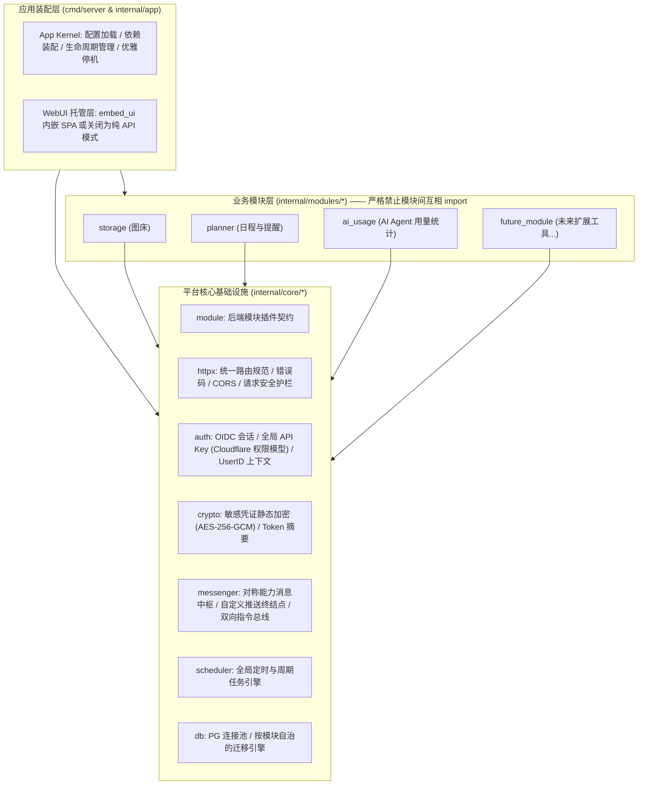
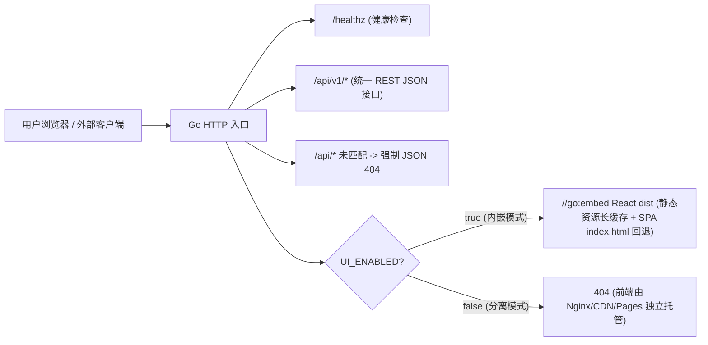
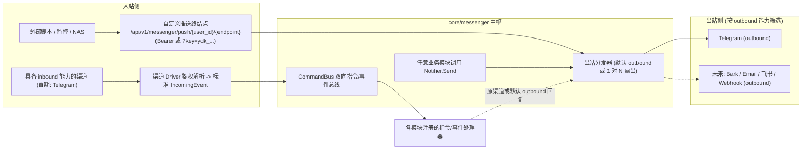

# YukiDeck：总体架构与平台底座设计

## 概述

本文档是 YukiDeck 的**顶层架构与平台底座设计稿**，聚焦于：宏观定位、模块化单体骨架、双部署机制，以及平台公共基础设施（`core/auth`、全局 API Key、`core/messenger`、`core/scheduler`、`core/db`）的职责与边界。

各具体业务模块的数据表、接口与页面设计均独立维护于各自的模块文档中。

---

## 一、宏观定位与核心设计原则

1. **个人自用为主、顺带多用户独立隔离**
   - 接入标准 **OIDC** 完成身份认证；业务数据天然按 `user_id` 隔离。
   - 所有外部依赖（对象存储、Telegram Bot 及后续接入的其他消息渠道）均由各用户独立填写自有凭证（BYOC），系统不提供共用托管资源。
2. **限制只为保护服务器安全，不做人为配额**
   - 不消耗服务器资源的路径（例如图床浏览器直传用户自己的对象存储）不做大小或数量限制。
   - 仅在实际经过或占用服务器资源的路径（后端中转文件流、常规请求体解析、批量上报护栏、外部 HTTP 超时、Webhook 入站鉴权）设置可配置的服务端安全护栏。
3. **模块化单体（Modular Monolith）优先**
   - 单一仓库、单进程交付；代码边界上严格实行**垂直切片 + 单向依赖隔离**。
4. **单二进制内嵌 + 前后端分离双部署模式**
   - 默认通过 Go `-tags embed_ui` 静态编译内嵌 React 构建产物，单二进制/单容器即可运行；同时保留完整的 API 边界与跨域配置，随时切换分离部署。

---

## 二、技术栈选型

| 层次 | 选型 | 选型依据 |
| :--- | :--- | :--- |
| **后端语言与 HTTP** | **Go + `go-chi/chi/v5`** | 100% 兼容标准库 `net/http`，无自定义 Context 锁定；子路由组合天然契合模块挂载、`embed.FS` 与 `httptest` 单测 |
| **数据库访问** | **外部 PostgreSQL + `pgx/v5` + `sqlc`** | 通过 `DATABASE_URL` 接入外部 PG；纯 SQL 生成强类型 Go 代码，编译期校验，各模块自治管理迁移与查询 |
| **底座核心库** | `log/slog`、`caarlos0/env`、`coreos/go-oidc/v3`、`robfig/cron/v3`、`aws-sdk-go-v2` | 轻量、低魔法、长期稳定的标准库与官方 SDK |
| **前端框架** | **React + TypeScript + Vite** | 静态产物易内嵌，搭配 React Router（懒加载分包）+ TanStack Query + Tailwind CSS |

---

## 三、宏观系统架构与部署视图

### 1. 系统逻辑分层与单向依赖铁律



**分层与依赖约束**：
- **严禁模块间横向耦合**：`internal/modules/A` 绝不允许 `import internal/modules/B`（由 `arch_test.go` 自动校验）。
- **`core/messenger` 定位为平台核心基础设施（与 `core/db`、`core/auth`、`core/scheduler` 同级）**：
  - 负责为全部业务模块提供统一的出站通知（`Notifier`）与入站双向交互总线（`CommandBus`，为后续复杂 Telegram Bot 交互预留一等接口）；
  - 前端形态以配置与设置为主，与 API Key 同属平台级配置，不作为独立末端业务模块拆分。

### 2. 内嵌单二进制 & 前后端分离双模式架构



框架层固化 4 项双模式约定：
1. **严格路径隔离**：所有后端接口统一按模块前缀挂载于 `/api/v1/<module>/*`；未命中的 `/api/*` 必须返回 JSON `404`，不穿透到 `index.html`。
2. **构建期与运行期双控制**：`-tags embed_ui` 控制是否编译内嵌产物；`UI_ENABLED` 环境变量控制运行期是否托管前端。
3. **可配置跨域与会话边界**：通过 `CORS_ALLOWED_ORIGINS`、`FRONTEND_BASE_URL` 及 Cookie 的 `Domain / Secure / SameSite` 保障分离部署下 OIDC 正常登录。
4. **前端单点适配**：前端所有请求统一走 `core/api`，读取 `VITE_API_BASE_URL`。

---

## 四、可扩展框架设计（前后端插件化契约）

### 1. 后端模块生命周期契约（`internal/core/module`）

```go
type Meta struct {
    ID          string `json:"id"`          // 唯一标识，决定 API 挂载前缀 /api/v1/{id}
    Name        string `json:"name"`
    Description string `json:"description"`
    APIPrefix   string `json:"api_prefix"`
}

type Module interface {
    Meta() Meta
    Migrations() fs.FS                                               // 可选：模块自治 SQL 迁移文件
    RegisterRoutes(r chi.Router)                                     // 注册模块 RESTful 路由（前端与外部 API Key 共用）
    RegisterPermissions(reg *auth.PermissionRegistry)                // 可选：声明对全局 API Key 开放的细粒度权限与可选资源
    RegisterJobs(ctx context.Context, sched *scheduler.Engine) error // 可选：向全局调度引擎注册后台任务
    RegisterCommands(bus *messenger.CommandBus)                      // 可选：向双向消息中枢注册指令/媒体事件
}
```

- **模块自治迁移机制**：迁移表按 `(module_id, version)` 记录版本，各模块独立演进 SQL 迁移。
- **能力发现与模块开关**：`GET /api/v1/meta` 宣告当前部署级已启用模块（由环境变量 `DISABLED_MODULES` 静态裁剪）；在此之上叠加**用户级模块开关**（`users.disabled_modules`），允许每个用户在「系统设置 → 通用」中按需隐藏/停用任意业务模块（不删除数据）。

### 2. 前端模块注册契约（`frontend/src/core/module.ts`）

```ts
export interface FrontendModule {
  id: string;
  name: string;
  description: string;
  icon: ComponentType<{ className?: string }>;
  basePath: string;
  routes: RouteObject[];               // 使用 React.lazy() 按模块分包懒加载
  settingsPanel?: {
    label: string;
    component: LazyExoticComponent<ComponentType>; // 注入到统一设置页的配置 Tab
  };
}
```

---

## 五、平台底座核心子系统设计

### 1. OIDC 鉴权、全局 API Key 与凭证保护（`core/auth` & `core/crypto`）

- **标准 OIDC 认证流**：基于 `coreos/go-oidc/v3` 实现 Authorization Code + PKCE，按 OIDC `sub` 建立本地用户映射并签发 `HttpOnly` 会话 Cookie。
- **全局 API Key（Cloudflare 风格细粒度权限模型）**：
  - **统一接口复用**：所有常规模块使用统一的 `/api/v1/<module>/*` RESTful 路由，前端（OIDC Cookie）与外部客户端（`Authorization: Bearer ydk_...`）调用完全同一套路径；常规接口**仅接受 Header 鉴权**，绝不接受 URL/Query 传 Key。
  - **前缀与存储**：Key 格式为 `ydk_<随机串>`，数据库仅存 `key_prefix` 与 SHA-256 摘要，明文仅在创建或轮换时展示一次；支持启用/禁用、轮换、吊销、可选过期时间与 `last_used_at`。
  - **默认拒绝（Fail-Closed）**：浏览器 OIDC 会话拥有用户全权；API Key 默认拒绝一切接口，仅放行显式挂载 `auth.RequirePermission(perm, resourceExtractor)` 且命中该 Key 策略的接口。管理类接口（管理 API Key、修改 OIDC/S3/渠道密钥等）始终仅认 OIDC 会话。
  - **模块自声明权限与资源（零业务耦合）**：
    - 各核心能力与业务模块向 `auth.PermissionRegistry` 注册 `PermissionDef`（`Key` 如 `ai-usage:ingest`、`messenger:push`，含 `ModuleID`、`Label`、`ResourceType`、`AllowQueryKey`）；
    - 如需细分到具体资源（如消息推送的单个终结点），模块额外注册一个 `ResourceLister(ctx, userID) ([]ResourceOption, error)` 回调，供设置页动态拉取可选资源，底座不感知任何业务表结构。
  - **策略格式（JSONB）**：每条 API Key 持有 1~N 条策略 `{ "permission": "<module>:<action>", "resources": ["*"] | ["<resource_id>", ...] }`。
- **用户级通用偏好（全局默认时区 & 模块开关）**：
  - `users` 表内置 `timezone`（IANA 时区，默认 `Asia/Shanghai`）与 `disabled_modules`（`TEXT[]`，默认 `{}`），随 `GET /api/v1/auth/me` 下发，并通过 `PATCH /api/v1/auth/preferences`（仅 OIDC 会话）在「系统设置 → 通用」Tab 统一管理。
  - **全局默认时区**：各业务模块（如 `screen-time` 后台拉取、`ai-usage` 看板默认时区、`planner` 新建日程默认时区）统一复用平台默认时区，不再在各自设置页重复维护全局时区项（需要单条目特例的模块如 `planner` 仍可保留单条覆盖）。
  - **用户级模块开关**：叠加在部署级 `DISABLED_MODULES` 之上；关闭某模块仅隐藏其侧边栏/首页/设置 Tab 入口，并由该模块后台任务跳过对应用户，**绝不删除历史数据**，重新打开即刻恢复；模块内不再重复设计冗余的「模块启用开关」。
- **敏感凭证静态加密**：用户填入的外部密钥统一经 `core/crypto`（AES-256-GCM，主密钥由 `APP_SECRET_KEY` 注入）加密落库，接口层永不回传明文。

### 2. 对称能力的统一消息中枢与自定义推送终结点（`core/messenger`）



- **对称渠道能力**：每个渠道驱动声明自身支持的 `outbound`（发送）和/或 `inbound`（接收）能力，用户可在实例上独立开关；出站与入站严格按对应能力对称筛选。
- **自定义推送终结点（路径分流 + 唯一允许查询参数鉴权的例外）**：
  - 推送终结点归属 `core/messenger`，用户可自定义多个命名的路由终结点 `slug`（如 `default`、`alert`、`nas`），每个终结点只维护转发规则（默认出站渠道或指定 1~N 个出站渠道），不再各自签发独立 Token。
  - 统一调用路径为 `GET/POST /api/v1/messenger/push/{user_id}/{endpoint}`，同时校验路径 `user_id` 与凭证归属一致、以及 API Key 是否具备 `messenger:push` 且资源范围覆盖 `{endpoint}`（或 `*`）。
  - 为兼容无法设置自定义 Header 的外部监控/NAS/快捷指令，**仅推送自定义终结点**显式标记 `AllowQueryKey: true`，同时支持 `Authorization: Bearer ydk_...` 与查询参数 `?key=ydk_...`（推荐为外部 URL 签发仅限单终结点的最小权限 Key），并兼容 Query / JSON / Form 常见参数别名（`title`、`content`/`text`/`body`/`msg`）。
- **基础传输级短重试（基础设施职责边界）**：`core/messenger` 出站发送内置秒级瞬时重试（默认最多重发 2 次，退避 `500ms → 1.5s`），自动消化网络闪断、`5xx` 与 `429` 限流，对配置错误或 `4xx` 永久失败（`PermanentError`）立即快速失败不重试，使 `PushURL`、机器人回复及全部业务模块零成本受益；需要与业务状态强绑定的分钟级持久化退避重试与生命周期取消（如 `planner` 的完成/暂停取消）则由各业务模块按需自行实现。
- **双向指令总线（`CommandBus`）**：具备 `inbound` 能力的渠道鉴权并归一化后投入 `CommandBus`，路由给各业务模块注册的处理器，为后续复杂的 Telegram 机器人交互提供统一底座。

### 3. 全局调度引擎（`core/scheduler`）

- 提供按 Key 动态热增删、时区支持、上下文超时控制与优雅停机的通用调度底座；对于日程提醒等稀疏精确触发场景，模块也可采用 PG 部分 B-Tree 索引 + 单 `time.Timer` 事件驱动唤醒。

### 4. 服务器安全护栏（Server Guardrails）

- 常规 JSON API / 推送请求体设置合理字节上限（防 OOM），批量上报接口加单批条数上限；
- 外部出站 HTTP 请求强制超时与响应体上限；
- 仅对实际经过服务器的文件流（如 `STORAGE_PROXY_MAX_MB`）设置硬上限，不经服务器的直传路径零限制。

---

## 六、业务模块规划与演进路线

| 阶段 | 模块 | 状态 |
| :--- | :--- | :---: |
| **Stage 1** | 平台骨架与底座（OIDC、PG 迁移器、双部署托管、对称消息中枢 + Telegram 驱动） | ✅ 已完成 |
| **Stage 2** | 图床模块（`storage`，直传不限大小 / 中转保护双模式） | ✅ 已完成 |
| **Stage 3** | 日程与提醒模块（`planner`，详见 [planner-module.md](./planner-module.md)） | ✅ 已完成 |
| **Stage 4** | 平台底座升级（全局 API Key + `messenger` 自定义推送终结点路径分流） | ✅ 已完成 |
| **Stage 5** | AI Agent 用量统计模块（`ai-usage` + `collector/`，详见 [ai-usage-module.md](./ai-usage-module.md)） | ✅ 已完成 |
| **Stage 6** | 物品价值计算模块（`assets`，详见 [assets-module.md](./assets-module.md)） | ✅ 已完成 |
| **Stage 7** | 剪切板模块（`clipboard`，详见 [clipboard-module.md](./clipboard-module.md)） | ✅ 已完成 |
| **Stage 8** | 平台用户偏好升级（全局默认时区 + 用户级模块开关）+ 使用时间模块（`screen-time`，详见 [screen-time-module.md](./screen-time-module.md)） | ✅ 已完成 |
