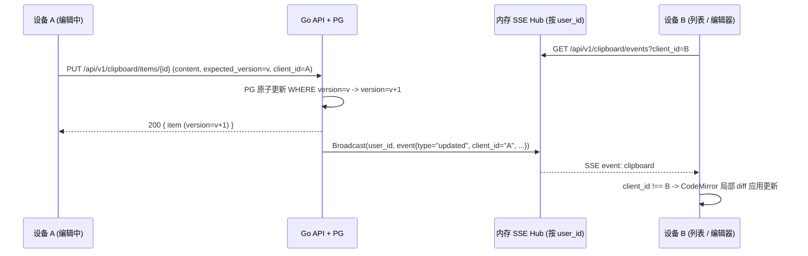

# 剪切板模块（`clipboard`）详细设计方案

## 目标与定位

在 YukiDeck 中接入垂直切片模块 **`clipboard`（云剪切板）**，提供一个面向个人跨设备（手机 / 桌面端）的极简纯文本云端中转与实时编辑工作区：

- **严格模块化边界**：后端位于 `backend/internal/modules/clipboard`，前端位于 `frontend/src/modules/clipboard`，仅依赖平台 `core/*`，**严禁** import 兄弟模块；数据严格按 `user_id` 隔离，全部接口仅认 OIDC 浏览器会话（本期不开放 API Key、不接入 TG Bot、不提供免登录公开分享）。
- **纯文本极简单实体**：图片与文件由图床模块（`storage`）承担，剪切板聚焦纯文本。无标题、无语言下拉框、无冗余分类字段，仅保留「正文 + 星标置顶 + 手动排序 + 到期时间 + 乐观锁版本号」。
- **可控有效期与随时续期**：新建默认有效期 **24 小时**，到期前随时可修改或延长到期时间，单次设置上限为「**当前时间 + 1 年**」；超过到期时间后即刻不可见并由后台定时物理清理。
- **服务端安全护栏**：通过环境变量 `CLIPBOARD_MAX_BYTES`（默认 **256 KiB** / `262144` 字节）限制单条文本 UTF-8 字节上限，保护服务器内存、数据库与 SSE 推送通道。
- **近似实时同步（防抖自动保存 + SSE）**：编辑页采用开源 **CodeMirror 6**（默认 Markdown + 常见代码块高亮，支持 Markdown 预览与分栏），输入防抖自动保存并通过按用户分组的内存 **SSE** 广播至其他在线标签页，接收端基于最小公共前后缀 diff 局部更新编辑器文档，不重置滚动条与光标。

---

## 一、核心规则与实时同步机制

### 1. 有效期与自动清理规则（方案 A）

- **默认到期时间**：创建条目时若未指定 `expires_at`，默认为 `NOW() + 24h`。
- **修改与续期上限**：创建与修改时均校验 `expires_at` 必须晚于当前时间，且不超过 `NOW() + 1 年`（服务端留 1 分钟时钟缓冲避免边界抖动）。只要条目尚未过期，可随时重新设置到期时间（例如即将满 1 年时再次延长至新的「当前时间 + 1 年」）。
- **逻辑实时失效 + 后台物理清理**：
  - 所有查询/更新/删除 SQL 均携带 `expires_at > NOW()` 过滤条件，保证到期即不可见；
  - 模块通过 `RegisterJobs` 向 `core/scheduler` 注册每 15 分钟执行一次的清理任务（`clipboard:purge-expired`），批量删除 `expires_at <= NOW()` 的过期记录。

### 2. 服务端大小护栏（`CLIPBOARD_MAX_BYTES`）

- 环境变量 `CLIPBOARD_MAX_BYTES` 默认 `262144`（256 KiB），通过 `GET /api/v1/clipboard/meta` 下发给前端展示实时容量占用与输入校验。
- HTTP JSON Body 读取上限取 `max(REQUEST_MAX_BODY_BYTES, CLIPBOARD_MAX_BYTES*2 + 65536)`，防止接近 256 KiB 的文本因 JSON 转义膨胀触发误拒；解析后严格按 `int64(len(content)) <= CLIPBOARD_MAX_BYTES` 校验，超限返回 HTTP `413 payload_too_large`。

### 3. 实时同步与并发冲突处理（防抖自动保存 + SSE + 乐观锁）



- **发端防抖**：小文本（≤ 64 KiB）输入停顿 **350ms** 自动保存；大文本（> 64 KiB）放宽至 **800ms**，减少大包频繁写入。支持 `Ctrl/Cmd + S` 立即保存。
- **SSE 负载分级**：
  - 变更条目 ≤ 64 KiB 时，SSE 事件直接携带完整 `item`，接收端零往返秒级同步；
  - 变更条目 > 64 KiB 时，SSE 仅下发轻量通知（`fetch_required: true`），由接收端按需调用 `GET /items/{id}` 拉取，避免大包阻塞 SSE 通道。
- **元数据与正文解耦**：星标（`starred`）与到期时间（`expires_at`）通过 `PATCH /items/{id}` 独立更新，**不递增正文 `version`**，避免在列表页点星标或延长时间时干扰已打开的编辑器。
- **乐观锁冲突保护**：正文保存携带 `expected_version`；若两端极偶然同时编辑触发版本不匹配，返回 HTTP `409 Conflict`（`code: "version_conflict"`），前端顶部弹出非破坏性冲突条，提供「加载最新版本」与「用当前内容覆盖」两个显式选项，绝不静默丢字。
- **基础设施保障**：
  - `core/httpx` 的 `statusRecorder` 补充 `Unwrap() http.ResponseWriter`，使 Go 标准库 `http.NewResponseController(w).Flush()` 可穿透日志中间件正常刷新 SSE；
  - SSE 响应设置 `X-Accel-Buffering: no` 并每 25 秒发送 `: ping` 心跳保活；
  - 每个 `user_id` 最多允许 16 条并发 SSE 连接（超出时淘汰最旧连接），保护单机文件描述符与内存。

---

## 二、数据模型（单表 `clipboard_items`）

迁移文件：`backend/internal/modules/clipboard/migrations/001_clipboard.sql`

```sql
CREATE TABLE IF NOT EXISTS clipboard_items (
    id          BIGSERIAL PRIMARY KEY,
    user_id     BIGINT NOT NULL REFERENCES users(id) ON DELETE CASCADE,
    content     TEXT NOT NULL DEFAULT '',
    byte_size   INT NOT NULL DEFAULT 0 CHECK (byte_size >= 0),
    starred     BOOLEAN NOT NULL DEFAULT FALSE,
    sort_order  INT NOT NULL DEFAULT 0,
    version     BIGINT NOT NULL DEFAULT 1 CHECK (version >= 1),
    expires_at  TIMESTAMPTZ NOT NULL,
    created_at  TIMESTAMPTZ NOT NULL DEFAULT NOW(),
    updated_at  TIMESTAMPTZ NOT NULL DEFAULT NOW()
);

CREATE INDEX IF NOT EXISTS idx_clipboard_items_user_updated
    ON clipboard_items(user_id, starred DESC, updated_at DESC, id DESC);
CREATE INDEX IF NOT EXISTS idx_clipboard_items_user_sort
    ON clipboard_items(user_id, starred DESC, sort_order ASC, id DESC);
CREATE INDEX IF NOT EXISTS idx_clipboard_items_expires
    ON clipboard_items(expires_at);
```

- **列表轻量化策略**：单条文本 ≤ 32 KiB 时，`GET /items` 直接返回 `content`（支持卡片「一键复制」在点击手势内同步写入系统剪贴板，兼容 Safari/移动端）；超过 32 KiB 时仅返回前 600 字符 `preview` 并标记 `content_omitted: true`，点击复制时按需拉取全文。

---

## 三、HTTP 接口设计（`/api/v1/clipboard/*`）

全部路由挂载 `auth.RequireSession`（仅限 OIDC 浏览器会话）：

| 方法与路径 | 说明 |
| :--- | :--- |
| `GET /meta` | 返回模块运行时配置（`max_bytes`、`default_ttl_seconds`、`max_ttl_days`、`sse_inline_max_bytes`） |
| `GET /items` | 列表查询，支持 `q`（关键词）、`starred=true`、`sort_by`（`manual` / `updated_at` / `created_at` / `expires_at`）、`sort_dir`（`asc` / `desc`），星标项始终优先置顶 |
| `POST /items` | 新建文本条目（默认 24 小时过期），返回 `201 { item }` 并广播 SSE `created` |
| `GET /items/{id}` | 获取单条完整文本，用于编辑器加载与大文本复制 |
| `PUT /items/{id}` | 更新正文（支持 `expected_version` 乐观锁、`force` 强制覆盖与可选 `expires_at`/`starred`），返回 `{ item }` 并广播 SSE `updated` |
| `PATCH /items/{id}` | 仅更新元数据（`starred` 和/或 `expires_at`），不递增正文版本号，广播 SSE `updated`（`meta_only: true`） |
| `DELETE /items/{id}` | 删除条目并广播 SSE `deleted` |
| `POST /items/reorder` | 提交完整 ID 顺序更新 `sort_order`（与 `assets` 模块一致），广播 SSE `reordered` |
| `GET /events` | SSE 实时事件流（`?client_id=<uuid>`），推送 `created` / `updated` / `deleted` / `reordered` 事件 |

---

## 四、前端界面与交互设计

风格严格遵循 YukiDeck 现有 Light Snow 极简规范（`yd-*` 组件类、天蓝主色、与 `assets` / `planner` / `storage` 保持一致）：

### 1. 列表页（`/clipboard`）
- **顶部栏**：模块标题 + 实时连接状态指示点 + 「新建文本」按钮；页面支持直接 `Ctrl/Cmd + V` 一键粘贴纯文本新建条目。
- **检索与工具栏**（参考 `assets` 的 `FilterBar`）：
  - 关键词搜索框 + 本地搜索历史下拉（最多保留 8 条）；
  - 分段筛选：`全部` / `星标`；
  - 排序下拉：`手动排序` / `最近更新` / `创建时间` / `即将到期` + 升降序切换；
  - 视图切换：卡片网格 / 紧凑列表（持久化到 `localStorage`）。
- **预览卡片 / 列表行**（参考 `planner` 与 `assets`）：
  - 展示正文摘要、字符/字节数、最近更新时间与剩余有效期徽标（< 6 小时琥珀色、< 1 小时红色）；
  - 点击卡片任意空白/正文区域直接进入 `/clipboard/:id` 编辑器；
  - 操作栏固定提供：**星标按钮**（置顶）+ **复制按钮**（一键复制全文并提示）+ **编辑按钮**（与点击卡片同效）+ **三个点「更多」菜单**（更改到期时间、星标/取消星标、删除）；
  - 手动排序模式下，桌面端支持拖拽重排。

### 2. 编辑器页（`/clipboard/:id`）
- **顶部工具栏**：返回列表、实时同步状态徽标（`已同步` / `保存中...` / `未保存` / `版本冲突`）、视图切换（`编辑` / 桌面端 `分栏` / `Markdown 预览`）、到期时间按钮（点开快捷选择 `1 小时 / 24 小时 / 7 天 / 30 天 / 1 年` 或自定义时间）、星标、一键复制、更多菜单（删除）。
- **编辑器内核**：CodeMirror 6，默认启用 Markdown + 常见代码块（JS/TS/Go/Python/JSON/YAML/Bash/SQL/HTML/CSS 等）通用语法高亮，支持行号、自动折行、`Ctrl/Cmd + F` 搜索替换与 `Ctrl/Cmd + S` 立即保存。
- **Markdown 预览**：使用 `marked` + `DOMPurify` 安全渲染，支持分栏实时联动与移动端单栏切换。
- **底部状态栏**：字数、行数、当前字节数 / 服务端上限（接近上限高亮提示）与 SSE 实时同步状态。
