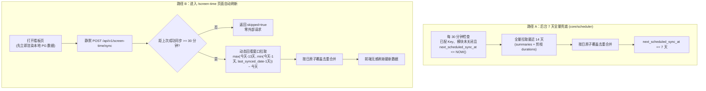

# 使用时间模块（`screen-time`）详细设计方案

## 目标与定位

在 YukiDeck 中接入垂直切片模块 **`screen-time`（使用时间）**，并同步补齐平台级**用户通用偏好（全局默认时区 + 用户级模块开关）**。模块首期聚焦 **WakaTime 编码使用时间的零侵入接入、永久归档与多维可视化**：

- **零侵入接入、本地零改动**：不修改本地 IDE 插件或 `~/.wakatime.cfg`，沿用用户现有的 WakaTime 官方（或兼容 WakaTime v1 API 的自托管 Wakapi）上报链路；用户在 YukiDeck 设置页独立配置自己的 API Key（BYOC），由服务端拉取。
- **突破官方免费版 14 天限制**：WakaTime 免费账号仅保留最近 14 天历史；YukiDeck 通过「每 7 天后台全量 14 天兜底 + 进页面按需增量拉取」将其持久化至用户自己的 PostgreSQL，自动形成永久历史归档，零手动维护负担。
- **日级多维明细 + 精确时间段双轨存储**：同时拉取 WakaTime `/summaries`（日级多维聚合）与 `/durations`（精确起止时间块），既支撑项目/语言/编辑器/设备/系统/分类全维度统计，又能绘制精确的**每日编码时间轴**与**24 小时活跃分布**。
- **极简克制、复用平台底座**：
  - 时区与模块启用开关全部收口至平台「系统设置 → 通用」（详见 [architecture.md](./architecture.md)），`screen-time` 自身不再重复配置时区与启用开关；
  - 前端不堆砌手动刷新按钮，设置页不堆砌复杂调度参数；本期仅覆盖 WakaTime，**不改动 `collector/`**，不接入 ManicTime / ActivityWatch / 浏览器扩展。
- **严格模块化边界与安全隔离**：后端位于 `backend/internal/modules/screen_time`，前端位于 `frontend/src/modules/screen_time`，仅依赖平台 `core/*`，**严禁** import 兄弟模块；所有数据严格按 `user_id` 隔离，外部 API Key 经 `core/crypto`（AES-256-GCM）加密落库，接口永不回传明文。

---

## 一、前置平台底座小升级：用户级通用偏好（`core/auth`）

为避免时区配置和模块开关在各个业务模块中重复出现，本阶段先在平台底座 `core/auth` 完成一次极薄升级：

1. **数据库迁移**（`backend/internal/core/auth/migrations/003_user_preferences.sql`）：
   ```sql
   ALTER TABLE users
       ADD COLUMN IF NOT EXISTS timezone TEXT NOT NULL DEFAULT 'Asia/Shanghai',
       ADD COLUMN IF NOT EXISTS disabled_modules TEXT[] NOT NULL DEFAULT '{}';
   ```
2. **后端能力与接口**：
   - `GET /api/v1/auth/me` 返回用户对象补充 `timezone` 与 `disabled_modules`；
   - 新增 `PATCH /api/v1/auth/preferences`（仅 OIDC 会话）：校验合法 IANA `timezone` 及已知模块 ID 后更新用户偏好；
   - `core/auth` 暴露只读偏好查询方法（如按 `user_id` 获取 `UserPreferences{Timezone, DisabledModules}`），供各模块服务层与后台任务直接复用，不破坏单向依赖铁律。
3. **前端统一设置与已有模块对齐**：
   - `SettingsPage` 新增 **「通用」Tab**，包含两块配置：**默认时区**（下拉选择 + 一键跟随浏览器时区）与 **功能模块开关**（列出服务端已启用的全部业务模块一键显隐/启停，不删历史数据）；
   - `useEnabledModules()` 在服务端 `/api/v1/meta` 列表基础上自动叠加过滤 `user.disabled_modules`（关闭某模块后，侧边栏、首页卡片、该模块设置 Tab 同步隐藏；若在 URL 直接访问已关闭模块路径，提示去「系统设置 → 通用」重新开启）；
   - **存量模块顺手对齐**：`ai-usage` 看板默认时区、`planner` 新建日程默认时区均优先读取平台 `user.timezone`（`planner` 单条日程仍允许独立覆盖）。

---

## 二、WakaTime 数据接入与同步机制

### 1. 为什么采用 API Key 而不是仅用户名

WakaTime 官方仅提供面向公开主页的滚动 7 天聚合快照（`/users/{username}/stats/last_7_days`），必须公开账号且无法按天拆分、无法获取精确时间段，不能支撑按日趋势、年度热力图和每日时间轴。

而使用用户自己的 **WakaTime API Key** 同样做到对本地编辑器**零侵入**，且能访问完整的私有 v1 接口：

| WakaTime v1 接口 | 用途 | 调用时机 |
| :--- | :--- | :--- |
| `GET /users/current` | 校验 Key 有效性，获取用户名与套餐信息 | 「测试连接」与保存配置 |
| `GET /users/current/summaries?start=YYYY-MM-DD&end=YYYY-MM-DD&timezone=<tz>` | 批量拉取区间内每日总时长及 6 维度明细（单次最多 14 天） | 后台 7 天兜底同步 / 进页面增量同步 |
| `GET /users/current/durations?date=YYYY-MM-DD&timezone=<tz>` | 拉取指定日期的精确编码时间段（`[started_at, duration, project]`） | 仅对 `summaries` 中有编码记录的日期按日拉取 |

- **鉴权方式**：统一使用 HTTP Header `Authorization: Basic base64(api_key + ":")`，避免把密钥放进 URL Query 泄露到代理或访问日志。
- **兼容自托管上游**：支持用户自定义 `api_base_url`（默认 `https://api.wakatime.com/api/v1`），顺带兼容自托管 **Wakapi** 等 WakaTime v1 兼容服务。
- **时区来源**：拉取 WakaTime 接口时统一传入用户的平台默认时区（`users.timezone`）。

### 2. 双模式自动同步策略（7 天全量兜底 + 进页面增量拉取）



两条同步链路职责清晰、互为补充：

1. **配置保存即生效（无冗余开关）**：
   - 只要「使用时间」模块未被用户在平台通用设置中关闭，且已保存有效的 WakaTime API Key，即自动进入同步状态；
   - 首次配置保存 API Key 时，服务端以当前时间为基准设定 `next_scheduled_sync_at = NOW() + 7 days`，并异步触发一次最近 **14 天**的首次全量拉取，让看板开箱即有近两周数据；
   - 若用户清除 API Key，则清空 `next_scheduled_sync_at` 并停止同步（保留已归档的历史数据）。
2. **后台 7 天全量兜底同步（`core/scheduler`）**：
   - 模块通过 `RegisterJobs` 注册轻量检查任务 `screen-time:scheduled-sync`（每 30 分钟扫描一次：已配 API Key、状态非 `auth_error`、用户未在 `users.disabled_modules` 中关闭 `screen-time`、且 `next_scheduled_sync_at <= NOW()`）；
   - 每满 **7 天**（自配置保存起算），无论期间用户是否打开过页面，都**全量拉取最近 14 天**的数据并按日自动去重覆盖合并，随后将 `next_scheduled_sync_at` 顺延至下一个 7 天周期；
   - 即使连续数周不打开页面，也能稳稳兜住 WakaTime 免费版 14 天窗口、一天不漏，同时具备近两周自动纠偏能力。
3. **进入页面按需增量同步（30 分钟最短冷却）**：
   - 用户进入 `/screen-time` 页面时，前端**不阻塞首屏渲染**，立即展示本地 PostgreSQL 已归档数据，同时静默调用 `POST /api/v1/screen-time/sync`；
   - **最短拉取冷却（30 分钟）**：若距离 `last_synced_at` 不足 **30 分钟**，服务端直接返回 `skipped: true`，不请求 WakaTime；若上次同步失败，则仅施加 **1 分钟**短防抖，不锁死 30 分钟；
   - **动态回看窗口**：满足冷却条件时，起点计算为 `max(今天 - 13 天, min(今天 - 1 天, last_synced_date - 1 天))`，终点为用户平台时区下的 `今天`（首次未同步则拉最近 14 天）。天天看时仅拉「昨天 + 今天」秒级完成；隔几天再看则自动补齐中间天数；
   - 页面**不放置手动刷新按钮**，顶部仅展示轻量同步状态指示（同步中 / 最近同步时间 / 鉴权失效提示）。
4. **去重合并、剪枝节流与安全护栏**：
   - **单日事务原子替换**：每一天在一个 PostgreSQL 事务内完成 `UPSERT screen_time_daily_totals` + 按 `(user_id, stat_date)` 删除重建 `screen_time_daily_dimensions` 与 `screen_time_durations`，天然去重幂等，绝不破坏范围之外的历史归档；
   - **无效请求剪枝**：拉完 `summaries` 后，只对 `total_seconds > 0`（或本地原本有数据需清空）的日期拉取 `/durations`，逐日请求间加 **200ms** 温和间隔防止触发 429；
   - **进程内单用户互斥锁**：避免 7 天后台任务与打开页面触发并发拉取同一用户；
   - **外部 HTTP 护栏**：单请求超时 **15 秒**、响应体上限 **10 MiB**，重定向时**禁止向跨域主机透传 `Authorization` 头**；
   - **错误降级**：遇到 `401 / 403` 时置状态为 `auth_error` 并暂停自动同步，界面提示检查 API Key（用户重新保存配置后自动恢复）；遇到网络抖动 / `429` / `5xx` 记录 `error`，不影响已有历史展示。

---

## 三、数据模型（4 张模块自治表）

迁移文件位于 `backend/internal/modules/screen_time/migrations/001_screen_time.sql`：

### 1. `screen_time_configs`（用户同步凭证与状态表）

每个 `user_id` 一行，极简保存 WakaTime 接入凭证与同步运行态（时区与模块总开关统一由 `users` 表管理，此处不冗余存储）：

```sql
CREATE TABLE IF NOT EXISTS screen_time_configs (
    user_id                BIGINT PRIMARY KEY REFERENCES users(id) ON DELETE CASCADE,
    api_base_url           TEXT NOT NULL DEFAULT 'https://api.wakatime.com/api/v1',
    api_key_enc            TEXT NOT NULL DEFAULT '',
    api_key_hint           TEXT NOT NULL DEFAULT '',
    wakatime_username      TEXT NOT NULL DEFAULT '',
    last_synced_at         TIMESTAMPTZ,
    last_sync_attempt_at   TIMESTAMPTZ,
    last_synced_date       DATE,
    last_sync_status       TEXT NOT NULL DEFAULT 'idle' CHECK (last_sync_status IN ('idle', 'ok', 'auth_error', 'error')),
    last_sync_error        TEXT NOT NULL DEFAULT '',
    next_scheduled_sync_at TIMESTAMPTZ,
    created_at             TIMESTAMPTZ NOT NULL DEFAULT NOW(),
    updated_at             TIMESTAMPTZ NOT NULL DEFAULT NOW()
);

CREATE INDEX IF NOT EXISTS idx_screen_time_configs_due
    ON screen_time_configs(next_scheduled_sync_at)
    WHERE api_key_enc <> '' AND last_sync_status <> 'auth_error' AND next_scheduled_sync_at IS NOT NULL;
```

### 2. `screen_time_daily_totals`（按日编码总览表）

记录每个自然日的总编码时长，支撑热力图、Streak 连续打卡、最佳单日与总趋势的毫秒级查询：

```sql
CREATE TABLE IF NOT EXISTS screen_time_daily_totals (
    user_id       BIGINT NOT NULL REFERENCES users(id) ON DELETE CASCADE,
    stat_date     DATE NOT NULL,
    total_seconds DOUBLE PRECISION NOT NULL DEFAULT 0 CHECK (total_seconds >= 0),
    timezone      TEXT NOT NULL,
    synced_at     TIMESTAMPTZ NOT NULL DEFAULT NOW(),
    PRIMARY KEY (user_id, stat_date)
);
```

### 3. `screen_time_daily_dimensions`（按日多维明细表）

将 WakaTime `summaries` 返回的 6 大维度统一存为关系窄表，直接由 PostgreSQL + `sqlc` 完成任意时间区间的排行与堆叠趋势聚合：

```sql
CREATE TABLE IF NOT EXISTS screen_time_daily_dimensions (
    user_id       BIGINT NOT NULL REFERENCES users(id) ON DELETE CASCADE,
    stat_date     DATE NOT NULL,
    dimension     TEXT NOT NULL CHECK (dimension IN ('project', 'language', 'editor', 'os', 'category', 'machine')),
    name          TEXT NOT NULL,
    total_seconds DOUBLE PRECISION NOT NULL DEFAULT 0 CHECK (total_seconds >= 0),
    PRIMARY KEY (user_id, stat_date, dimension, name)
);

CREATE INDEX IF NOT EXISTS idx_screen_time_daily_dims_lookup
    ON screen_time_daily_dimensions(user_id, dimension, stat_date DESC);
```

> 存储量级估算：单人每日约 15~30 行维度明细（约 1 万行/年），PostgreSQL 查询保持亚毫秒级响应。

### 4. `screen_time_durations`（精确编码时间段表）

保存来自 WakaTime `/durations` 的连续编码区块，用于渲染**每日编码时间轴**与精确计算 **24 小时活跃分布**：

```sql
CREATE TABLE IF NOT EXISTS screen_time_durations (
    id               BIGSERIAL PRIMARY KEY,
    user_id          BIGINT NOT NULL REFERENCES users(id) ON DELETE CASCADE,
    stat_date        DATE NOT NULL,
    started_at       TIMESTAMPTZ NOT NULL,
    duration_seconds DOUBLE PRECISION NOT NULL CHECK (duration_seconds >= 0),
    project          TEXT NOT NULL DEFAULT '',
    color            TEXT NOT NULL DEFAULT ''
);

CREATE INDEX IF NOT EXISTS idx_screen_time_durations_user_date
    ON screen_time_durations(user_id, stat_date, started_at ASC);
CREATE INDEX IF NOT EXISTS idx_screen_time_durations_user_started
    ON screen_time_durations(user_id, started_at DESC);
```

- **24 小时分布精确切分算法**：服务端读取区间内的 `screen_time_durations` 后，按查询时区（默认用户平台时区 `users.timezone`）将每个 `[started_at, started_at + duration_seconds]` 区块按整点边界精确拆分累加至对应的 `0..23` 小时桶（例如 `10:50 ~ 11:20` 自动拆为 10 点 `600s` + 11 点 `1200s`），确保跨小时与跨时区统计准确无失真。

---

## 四、后端权限声明与 HTTP 接口（`/api/v1/screen-time/*`）

模块 ID：`screen-time`，路由挂载于 `/api/v1/screen-time`。所有对外请求/响应 DTO 统一收敛至 `backend/internal/modules/screen_time/dto.go`，并通过 `tygo` 生成 `frontend/src/modules/screen_time/api.gen.ts`。

### 声明的 API Key 权限（`RegisterPermissions`）

- `screen-time:read`：允许读取使用时间总览、趋势、热力图、多维排行、24 小时分布与每日时间轴（不含配置修改、测试连接与触发同步）。

### 接口清单

| 方法与路径 | 允许鉴权 | API Key 权限 | 说明 |
| :--- | :--- | :--- | :--- |
| `GET /api/v1/screen-time/summary` | Cookie / Bearer | `screen-time:read` | 区间总览（总编码时长、活跃天数、活跃日均/自然日均、当前与历史最长 Streak、最佳单日、Top 项目/语言/编辑器、是否已配置与最近同步状态） |
| `GET /api/v1/screen-time/trends` | Cookie / Bearer | `screen-time:read` | 趋势图数据，支持 `start`/`end`、`granularity`（`day` / `week` / `month`）、`group_by`（`total` / `project` / `language` / `editor` / `category` / `os` / `machine`）、`top_n`（默认 6，其余归入「其他」） |
| `GET /api/v1/screen-time/heatmap` | Cookie / Bearer | `screen-time:read` | 年度每日热力图（支持 `year=YYYY` 或默认最近 365 天，返回每日秒数与 0~4 强度分档） |
| `GET /api/v1/screen-time/breakdowns` | Cookie / Bearer | `screen-time:read` | 区间内多维排行（`projects` / `languages` / `editors` / `operating_systems` / `categories` / `machines`，含总秒数与占比，支持 `limit`） |
| `GET /api/v1/screen-time/hourly` | Cookie / Bearer | `screen-time:read` | 区间内按用户平台时区（支持可选 `tz` 覆盖）精确切分的 24 小时活跃分布（0~23 点累计秒数与活跃日均值） |
| `GET /api/v1/screen-time/timeline` | Cookie / Bearer | `screen-time:read` | 指定日期（`date=YYYY-MM-DD`，默认今天）的每日编码时间轴（当日总时长、项目明细与有序 `[started_at, ended_at, duration_seconds, project, color]` 片段列表） |
| `POST /api/v1/screen-time/sync` | 仅 OIDC Cookie | — | 进页面自动增量同步入口：自动校验模块开启态、已配 Key、30 分钟冷却与并发锁，命中冷却返回 `skipped: true`，否则按动态回看窗口拉取并合并，返回同步结果与最新同步时间 |
| `GET /api/v1/screen-time/config` | 仅 OIDC Cookie | — | 获取当前用户的 WakaTime 配置与最近同步状态（仅返回 `has_api_key` 与脱敏尾号 `api_key_hint`，永不返回明文 Key） |
| `PUT /api/v1/screen-time/config` | 仅 OIDC Cookie | — | 保存必要配置（`api_base_url`、`api_key` 留空保持原密文、可选 `clear_api_key`）；首次保存 Key 时自当前时间起算 7 天周期并异步触发 14 天初始化同步 |
| `POST /api/v1/screen-time/config/test` | 仅 OIDC Cookie | — | 测试 WakaTime 连通性（支持传入待保存的临时 `api_base_url`/`api_key` 或复用已保存配置，返回识别到的 `username`、`timezone`、`plan`） |

---

## 五、前端界面与交互设计（`frontend/src/modules/screen_time`）

遵循 YukiDeck 现有 Light Snow 极简视觉体系与 [ai-usage-module.md](./ai-usage-module.md) 的数据看板风格（页面通过 `React.lazy` 懒加载分包，并注入 `FrontendModule.settingsPanel` 统一设置页 Tab）。

### 1. 主看板（`/screen-time`）

- **未配置引导态**：首次进入且尚未配置 WakaTime API Key 时，展示简洁的配置说明卡片（说明本地 IDE 零改动、自动归档永久留存）与一键跳转设置页按钮。
- **进页面静默同步**：组件挂载且已配置 Key 时，立刻加载本地统计数据渲染看板，同时后台发起一次 `POST /api/v1/screen-time/sync`；若实际拉取了新数据（`synced: true`），自动静默失效刷新当前看板 Query。
- **顶部工具栏**：
  - 快捷时间范围切换：`今日` / `近 7 天` / `近 30 天` / `近 90 天` / `今年` / `全部` + 自定义起止日期；
  - 轻量同步状态胶囊（仅展示「正在同步最新数据… / 最近同步于 xx / 鉴权失效请检查配置」，**不放置手动刷新按钮**）。
- **核心指标卡（4 张）**：
  1. **总编码时长**：区间内总计（格式化如 `42h 18m`），副标展示与上一等长周期的环比变化；
  2. **日均时长**：活跃日均时长，副标展示区间自然日均；
  3. **活跃天数 / Streak**：区间活跃天数，副标展示当前连续编码天数与历史最长 Streak；
  4. **最佳单日**：区间内编码最长的一天（日期 + 时长，点击可直接定位到当日时间轴）。
- **多维趋势图**：
  - 支持切换聚合粒度（`按日` / `按周` / `按月`）与堆叠维度（`总计` / `项目` / `语言` / `编辑器` / `分类` / `设备`）；
  - 悬停 Tooltip 展示当日/周期总时长及 Top 分项明细与占比。
- **年度热力图 + 24 小时活跃分布（双栏布局，移动端上下堆叠）**：
  - **年度热力图**：支持切换年份 / 近一年，颜色深浅映射每日编码时长；**点击任意日期方块，直接联动切换下方「每日编码时间轴」到该日期**；
  - **24 小时活跃分布**：展示 0:00 ~ 23:00 的编码时段分布，直观呈现作息与高峰编码窗口。
- **每日编码时间轴（Day Timeline）**：
  - 顶部日期切换器（`前一天` / 日期选择器 / `后一天` / `今天`）+ 当日总时长；
  - `00:00 ~ 24:00` 横向时间轴按项目着色渲染各连续编码区块，悬停显示精确起止时间、持续时长与项目名；
  - 下方展示当日各项目的横向占比条明细。
- **多维排行卡片组**：
  - 卡片网格展示区间内的 **项目（Projects）**、**语言（Languages）**、**编辑器（Editors）**、**分类（Categories）**、**设备（Machines）** 与 **操作系统（OS）** 排行与占比进度条。

### 2. 统一设置页 Tab（`ScreenTimeSettingsPanel`）

挂载于平台统一设置页的「使用时间」Tab，保持极致简洁，**只保留最必要的 2 个字段**：

- **API Base URL**（默认 `https://api.wakatime.com/api/v1`，提示兼容自托管 Wakapi）
- **WakaTime API Key**（密码输入框；已配置时展示脱敏尾号如 `waka_...3f9a`，留空保存不覆盖原 Key，支持清空）
- **操作按钮**：**「测试连接」**（校验 Key 并回显识别到的 WakaTime 用户名）+ **「保存配置」**
- **状态摘要与引导**：只读展示当前同步状态、最近同步时间（及异常原因），底部一行小字提示「全局默认时区与模块启用开关可在『通用』中统一管理」。

---

## 六、接入清单与验证标准

实施时严格遵循 [module-guide.md](./module-guide.md)，分两步有序推进：

1. **Step 1：平台用户偏好底座升级（`core/auth` + `SettingsPage`）**
   - 新增 `backend/internal/core/auth/migrations/003_user_preferences.sql`、更新 `/api/v1/auth/me` 与 `PATCH /api/v1/auth/preferences`；
   - 前端 `SettingsPage` 新增「通用」Tab（全局默认时区 + 用户级模块开关），更新 `useEnabledModules()`，并让 `planner` 与 `ai-usage` 默认时区读取平台配置。
2. **Step 2：`screen-time` 模块前后端实现**
   - 后端新增 `backend/internal/modules/screen_time/`（`module.go`、`dto.go`、`handler.go`、`service.go`、`store.go`、`wakatime_client.go`、`queries.sql`、`migrations/001_screen_time.sql`、`screen_time_test.go`）；
   - 更新 `backend/internal/app/registry.go`、`backend/sqlc.yaml`、`backend/tygo.yaml`，执行 `make gen` 提交生成的 `sqlcgen/` 与 `frontend/src/modules/screen_time/api.gen.ts`；
   - 前端新增 `frontend/src/modules/screen_time/` 并在 `frontend/src/modules/index.ts` 注册。
3. **测试与验证标准**：
   - 单元测试覆盖：用户偏好更新与非法时区/未知模块校验、WakaTime Mock HTTP 客户端（含 `200`/`401`/`429`/`5xx`/跨域重定向不透传 Auth 头）、7 天全量 14 天兜底与去重覆盖、关闭模块跳过后台同步、进页面 30 分钟冷却与动态回看窗口、零编码日期剪枝、24 小时跨整点切分、Streak 计算与多用户 `user_id` 隔离；
   - `cd backend && go test -race ./...`（含 `TestNoCrossModuleImports` 架构隔离检查）；
   - `cd frontend && pnpm typecheck && pnpm build`。

---

## 七、后续可选演进（本期不做）

- **历史导出导入**：支持导入 WakaTime 官方导出的历史 JSON，补齐接入前超过 14 天的历史记录；
- **消息中枢联动**：接入 `core/messenger` 与 `core/scheduler`，支持编码日报/周报推送至 Telegram 或 `/time` 指令查询；
- **多数据源扩展**：未来如需补充全桌面软件使用时间，可在同模块内新增独立桌面轨道表，与现有 WakaTime 编码轨道并列展示、互不干扰。
